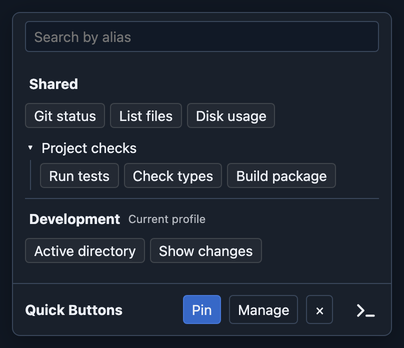
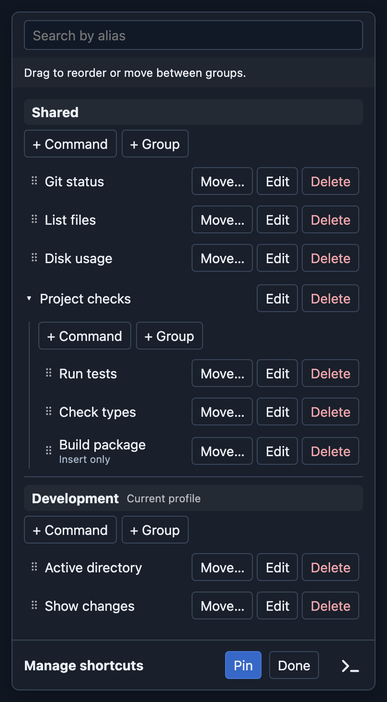
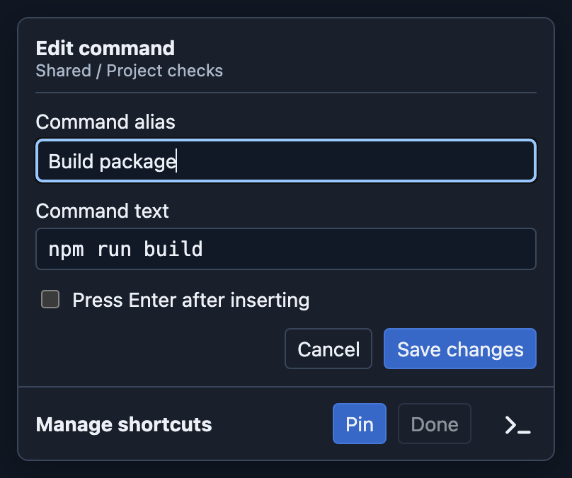

# Tabby Quick Buttons

Save frequently used terminal commands as clickable shortcuts in Tabby. Organize them in shared groups or keep them specific to a saved connection.

[中文介绍](#中文) · [npm](https://www.npmjs.com/package/tabby-quick-buttons) · [GitHub issues](https://github.com/vzpd/tabby-quick-buttons/issues)

## Screenshots · 截图

The screenshots show the plugin with sample commands. The plugin interface is in English.

| Manage shortcuts · 管理指令 | Edit a command · 编辑指令 |
| --- | --- |
|  |  |

## Install

1. In Tabby, open **Settings → Plugins**.
2. Search for **quick-buttons** and install **tabby-quick-buttons**.
3. Reopen Tabby and open a terminal. Hover over the floating button in the lower-right corner, or use the **Quick Buttons** icon in the toolbar.

## Use Quick Buttons

- **Run or insert a command.** Click its alias to send the saved text to the focused terminal pane. **Press Enter after inserting** is on by default. Turn it off to review or edit the line in the terminal before pressing Enter yourself.
- **Keep the panel handy.** Drag the floating button to position it. Hover to open the panel. Use **Pin** to keep it open and click **Pin** again to restore automatic closing when the pointer leaves.
- **Organize shortcuts.** **Shared** is available across connections. The current profile section is available only when using that saved profile. Both sections support nested groups. Profile-specific groups follow the profile ID when you rename it.
- **Manage or find a shortcut.** In **Manage**, add, edit, or delete commands and groups. Drag a command to reorder it or move it to another group. Use **Move…** to choose a destination directly. Search by alias across visible groups and press **Esc** to cancel an edit or clear the search.

Commands are stored in Tabby’s configuration. Use shortcuts at an empty shell prompt and keep passwords and tokens out of command text.

## Install a local build

Run `npm ci` and `npm pack` in this repository. In Tabby, open **Settings → Plugins → Open Plugins Directory**. In that directory, run `npm install /absolute/path/to/the-generated-package.tgz`, then reopen Tabby.

## 中文

Tabby Quick Buttons 可以把常用终端命令保存成短别名，点击即可填入当前聚焦的终端。公共命令与连接专属命令可以分别管理，支持多级分组。

### 安装

1. 在 Tabby 打开 **Settings → Plugins**。
2. 搜索 **quick-buttons**，安装 **tabby-quick-buttons**。
3. 重新打开 Tabby 并进入终端。将鼠标移到右下角浮球即可打开面板，也可以点击工具栏里的 **Quick Buttons** 图标。

### 使用

- **执行或只填入。** 点击别名会发送保存的一行指令。**Press Enter after inserting** 默认开启。关闭后可在终端里检查或修改，再手动回车。
- **移动或固定面板。** 拖动浮球可以调整位置。悬停展开，移开自动收起。点 **Pin** 后面板会保持展开，再点一次可取消固定。
- **公共和专属分组。** **Shared** 在所有连接里可用。专属分组只在对应的已保存连接下显示，重命名连接后仍能使用。没有保存配置 ID 的临时连接也能使用 **Shared**。
- **管理和搜索。** 点 **Manage** 新增、编辑或删除指令和分组。拖动可以排序或换组，也可以点 **Move…** 直接选目标分组。搜索按别名匹配当前可见的指令。按 **Esc** 可以取消当前编辑或清除搜索。

指令保存在 Tabby 配置里。请在空的 shell 提示符处使用快捷指令，并避免把密码或令牌写进指令。

### 常见问题

- **找不到面板。** 先打开一个终端标签页，再找右下角浮球或工具栏的 **Quick Buttons** 图标。
- **找不到某个专属分组。** 切换到创建这个分组时使用的连接配置。搜索结果也会随当前连接变化。
- **点击后只填入，没执行。** 检查该条指令的 **Press Enter after inserting** 设置。

### 从源码本地安装

在仓库目录执行 `npm ci` 和 `npm pack`。从 **Settings → Plugins → Open Plugins Directory** 打开 Tabby 插件目录，在该目录执行 `npm install /安装包的绝对路径.tgz`，然后重新打开 Tabby。
